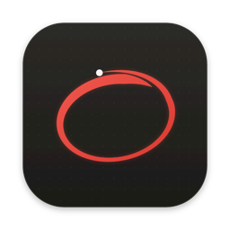

<p align="center"></p>

# Basit Çizim Uygulaması

macOS ekranının üstüne çizim yapmak için şeffaf katman. Canlı yayında, ekran
kaydında ya da sunumda mevcut ekranın üstüne çizerek anlatırsın; kapatınca her
şey silinir.

Eğitim verenler, canlı yayın yapanlar ve sunum yapanlar için: minimal, kafa
karıştırmayan, saniyesinde açılıp kapanan bir ekran üstü kalem. Baştan sona
[Claude Code](https://claude.com/claude-code) ile yapıldı.

*English below.*

- Ekranda araç çubuğu yok: çizim alanını kapatmaz, tıklamayı yemez.
- Hıza göre incelen, kalem hissi veren çizgi.
- Çoklu ekran: her ekranda çalışır, imleç hangi ekrandaysa orada çizersin.
- Dock'ta ikon yok, arka planda kısayol bekler; açılışta kendiliğinden başlar.

## Kurulum

**Terminal**'i aç (Spotlight'ta "Terminal" yaz), bu satırı yapıştır, Enter'a bas:

```bash
curl -fsSL https://raw.githubusercontent.com/merterhann/basit-cizim-uygulamasi/main/kur.sh | bash
```

Hepsi bu. En son sürümü indirir, Uygulamalar klasörüne koyar ve açar.
Güncellemek için aynı satırı tekrar çalıştır. Satırın ne yaptığını görmek
istersen: [`kur.sh`](kur.sh).

M1 ve sonrası (Apple Silicon) Mac'ler için. Intel Mac'te aşağıdaki
"Kaynaktan derle" adımlarını izle.

<details>
<summary>Terminal kullanmadan kurmak</summary>

1. [Releases](https://github.com/merterhann/basit-cizim-uygulamasi/releases/latest)
   sayfasından zip'i indir, çift tıklayıp aç.
2. Çıkan uygulamayı Finder'da **Uygulamalar** klasörüne sürükle.
3. Çift tıkla. macOS "doğrulanamadı" derse **Bitti**'ye bas, sonra
   **Sistem Ayarları → Gizlilik ve Güvenlik** sayfasının altındaki
   **Yine de Aç**'a tıkla. (Uygulama Apple geliştirici hesabıyla imzalı değil.)

</details>

## Kullanım

| Kısayol | Ne yapar |
|--|--|
| `Ctrl+Option+Cmd+Shift+9` | Çizimi aç / kapat (kapatınca her şey silinir) |
| `Ctrl+Option+Cmd+Shift+8` | Silgi aç / kapat |
| `E` ya da `8` | Silgi aç / kapat |
| `[` `]` | Kalem kalınlığı |
| `C` | Temizle |
| `Cmd+Z` | Geri al |
| `B` | Zemin: şeffaf → beyaz → siyah |
| `Esc` | Kapat ve sil |

Dört tuşlu kısayollar bilerek seçildi: hiçbir uygulamayla çakışmaz, klavyeden
yanlışlıkla basılmaz. Asıl kullanım bunları **mouse yan tuşlarına** atamaktır.
Örneğin Logitech Options+ ile yan tuşa "Keystroke" atayıp
`Ctrl+Option+Cmd+Shift+9` girersin; tek tuşla çizim açılır.

Kalem kırmızıdır; renk paleti bilerek yok.

## Kaynaktan derle

Node.js 18+ gerekir.

```bash
git clone https://github.com/merterhann/basit-cizim-uygulamasi.git
cd basit-cizim-uygulamasi
npm install
npm start          # geliştirirken
npm run dist       # dist/mac-arm64/BasitCizim.app
```

Çizgi hissini değiştirmek için `index.html` en üstündeki `TUNING` nesnesine
bak: `base` (kalınlık), `vMax` (en ince hız), `thinning` (hız etkisi),
`streamline` (akıcılık).

---

## English

A transparent drawing overlay for macOS. Draw on top of your screen while
teaching, streaming, recording or presenting; everything is wiped when you
close it. Minimal, instant to open and close, nothing to configure. Built
entirely with [Claude Code](https://claude.com/claude-code).

- No on-screen toolbar: nothing covers your content or steals clicks.
- Velocity-based stroke width that feels like a real pen.
- Multi-monitor: works on every display, you draw wherever the cursor is.
- No Dock icon; it waits for the hotkey in the background and starts at login.

### Install

Open **Terminal**, paste this line and press Enter:

```bash
curl -fsSL https://raw.githubusercontent.com/merterhann/basit-cizim-uygulamasi/main/kur.sh | bash
```

That's it. It downloads the latest release, puts it in Applications and opens
it. Run the same line again to update. See what it does: [`kur.sh`](kur.sh).

For Apple Silicon (M1 and later). On Intel Macs, build from source.

<details>
<summary>Install without Terminal</summary>

1. Download the zip from
   [Releases](https://github.com/merterhann/basit-cizim-uygulamasi/releases/latest)
   and double-click to unzip.
2. Drag the app into **Applications** in Finder.
3. Double-click it. If macOS says it cannot be verified, click **Done**, then
   **System Settings → Privacy & Security → Open Anyway**. (The app is not
   signed with an Apple Developer ID.)

</details>

### Shortcuts

| Shortcut | Action |
|--|--|
| `Ctrl+Option+Cmd+Shift+9` | Toggle the overlay (closing clears it) |
| `Ctrl+Option+Cmd+Shift+8` | Toggle eraser |
| `E` or `8` | Toggle eraser |
| `[` `]` | Pen size |
| `C` | Clear |
| `Cmd+Z` | Undo |
| `B` | Background: transparent → white → black |
| `Esc` | Close and clear |

The four-modifier hotkeys never clash with other apps. They are meant to be
mapped to **mouse side buttons** (e.g. a "Keystroke" action in Logitech
Options+), so one button opens the overlay.

### Build from source

Requires Node.js 18+.

```bash
git clone https://github.com/merterhann/basit-cizim-uygulamasi.git
cd basit-cizim-uygulamasi
npm install
npm start          # development
npm run dist       # dist/mac-arm64/BasitCizim.app
```

Tweak the pen feel with the `TUNING` object at the top of `index.html`.

## Lisans / License

[MIT](LICENSE)
